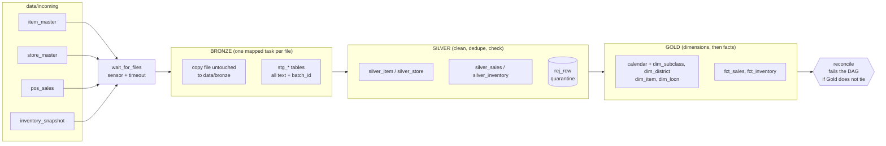

# Assignment 2.3 – Retail Daily ETL (Airflow → Snowflake Gold)

An Airflow pipeline that loads four daily retail files into the Gold model built in Assignment 2.1. It follows a medallion layout (Bronze → Silver → Gold), keeps history with SCD1/SCD2 and a positional inventory fact, quarantines bad rows with a reason code instead of failing, can be re-run safely, and ends with a reconciliation task that fails the DAG if Gold does not tie back to the source files.

**At a glance**

| | |
|---|---|
| Orchestrator | Apache Airflow 3 (CeleryExecutor, Docker) |
| Warehouse | Snowflake (credentials only in the Airflow connection `snowflake_default`) |
| DAG | `retail_daily` – `@daily`, `start_date` 2026-09-13, `end_date` 2026-09-17, `catchup=True`, `max_active_runs=1` |
| Input | 4 CSV feeds × 5 days = 20 files in `data/incoming/` |
| Tasks per day | 22 (1 init, 1 sensor, 4 mapped ingest, 5 silver, 10 gold, 1 reconcile) |
| Tests | 9 pipeline-logic tests + 6 DAG checks (`pytest`; 3 of the DAG checks need Airflow and run in the container) |

---

## 1. Architecture



DAG task order for one run date:

```
init_tables → wait_for_files → ingest_file[item_master | store_master | pos_sales | inventory_snapshot]
            → silver  (item, store → sales, inventory → quarantine)
            → gold    (calendar ; subclass → item ; district → locn ; then fct_sales, fct_inventory)
            → reconcile
```

---

## 2. The source files

All four files arrive for every run date, named with the date (`YYYYMMDD`), and are validated against an exact header.

| File | Content | Feeds | Load type |
|---|---|---|---|
| `item_master_YYYYMMDD.csv` | daily item snapshot (id, name, description, unit of measure, subclass id and name) | `DIM_ITEM`, `DIM_SUBCLASS` | item = **SCD2**, subclass = **SCD1** |
| `store_master_YYYYMMDD.csv` | store snapshot (id, name, district id and name, currency) | `DIM_LOCN`, `DIM_DISTRICT` | store = **SCD2**, district = **SCD1** |
| `pos_sales_YYYYMMDD.csv` | daily sale lines (sale id, line no, store, item, qty, net amount, discount, tax) | `FCT_SALES` | delete + insert per day |
| `inventory_snapshot_YYYYMMDD.csv` | daily stock position per item/store (on hand, on order, reorder point) | `FCT_INVENTORY` | positional (rows closed, never deleted) |

The store master is a *weekly* snapshot in the assignment slides; the generated data delivers it daily so the sensor can wait for all four files every day.

### The dataset (`tools/make_data.py`)
Deterministic (fixed text seeds, standard library only): 5 days, 2026-09-13 to 2026-09-17.
About 40–42 stores in 8 districts, 30 subclasses and ~380 everyday retail items (snacks, dairy, produce, electronics, …); roughly 2,600–3,300 sales lines and 5,700–6,200 inventory positions per day (**45,805 source rows** in total). Stock is simulated, so sales lower on-hand, reorder points trigger deliveries (`on_order_qty`), a few late suppliers cause stockouts, and the two files agree with each other. The original small 12-item dataset is kept in `data/incoming_original/` (`tools/make_data_original.py`).

**Planted scenarios**

| Date | Event | Demonstrates |
|---|---|---|
| 09-14 | subclass `SC2` renamed "Drinks" → "Drinks & More"; item `I020` renamed | SCD1 in place; SCD2 item version |
| 09-15 | store `1004` moves district D2 → D3; subclass `SC10` renamed; 6 new items | SCD2 location; SCD1; new items |
| 09-15 | **quarantine day** – see §6 | quarantine and counting |
| 09-16 | item `I007` moves subclass SC2 → SC3; store `1017` moves D4 → D6; district `D5` renamed; stores `1041`/`1042` open; 4 items flagged DISCONTINUED; 40 inventory positions disappear | SCD2 item/location; SCD1; positional close |
| 09-17 | store `1040` closes; store `1022` moves D1 → D8; item `I050` changes subclass; discontinued items leave all stores | closes, more SCD2 |

---

## 3. Layers in detail

All layers live in one Snowflake schema (the one set on the `snowflake_default` connection).

### Bronze – raw, untouched
- Each file is copied **byte for byte** to `data/bronze/<file>/ds=<date>/`; the original is never edited.
- Rows are then loaded as **text** into a staging table (`stg_item_master`, `stg_store_master`, `stg_pos_sales`, `stg_inventory`) with `batch_id` (= run date), `src_file` and `src_row_no`. Nothing can fail on a bad value at this stage.
- Header must match exactly, otherwise the task fails (a wrong file is a stop-the-line problem, a bad *row* is not).
- A line with the wrong number of fields is written to quarantine as `BAD_ROW_SHAPE`.
- Loading replaces the day's batch (`DELETE … WHERE batch_id = ds`, then insert), so re-ingesting gives the same result.

### Silver – clean, dedupe, check
One SQL file per table in `include/sql/silver/`. Each builds typed rows for the run date. Every row carries `reject_cd` (NULL = good). Item, store and inventory rows also carry `action_cd`, the decision Gold will carry out:

| `action_cd` | Meaning |
|---|---|
| `NEW` | never seen before → insert |
| `CHANGE` | a tracked attribute differs → close the open version, open a new one |
| `CORRECT` | the same-day version needs fixing → update in place |
| `NOCHANGE` | identical to the version that covers the date → do nothing |
| `STALE` | a newer version already exists (an older day is being re-run) → ignore |

`quarantine.sql` copies every rejected row to `rej_row` (rebuilt per run date).

### Gold – the Assignment 2.1 model
One SQL file per table in `include/sql/gold/`, dimensions before facts.

| Table | Method |
|---|---|
| `dim_year`, `dim_month`, `dim_week`, `dim_day` | calendar rows for the run date, inserted if missing |
| `dim_subclass`, `dim_district` | **SCD1** – name overwritten in place |
| `dim_item`, `dim_locn` | **SCD2** – new version per change, surrogate key generated by the table's `AUTOINCREMENT` |
| `fct_sales` | delete the day, re-insert clean lines, joined to the item/store **version valid on the sale date** |
| `fct_inventory` | **positional** – rows are closed (end date), never deleted |

Parents the files cannot provide (chain, area, region, department, category, brand, supplier, location type) hold one seed row (`UNKNOWN` / `STORE`, created by `init/03_seeds.sql`) so the model's NOT NULL keys always resolve. `dim_customer` is empty (no customer feed) and `fct_sales.customer_key` is NULL.

---

## 4. History handling

### SCD1 – `dim_subclass`, `dim_district`
Changed names are updated **in place**; no history is kept. `effective_start_dt` holds the date the current value was applied. A re-run of an older day can therefore never overwrite a newer value.

### SCD2 – `dim_item`, `dim_locn`
Tracked attributes – item: name, description, unit of measure, subclass; store: name, district, currency.

```
before 09-15:  locn 1004 │ D2 │ start 1900-01-01 │ end 9999-12-31 │ active
after  09-15:  locn 1004 │ D2 │ start 1900-01-01 │ end 2026-09-14 │ inactive
               locn 1004 │ D3 │ start 2026-09-15 │ end 9999-12-31 │ active     ← new surrogate key
```
- The first version of a key starts at `1900-01-01` so facts of any date find it.
- Sales use the version whose date range covers the sale date, so a 09-14 sale stays in D2 and a 09-16 sale lands in D3.

### Positional – `fct_inventory`
One row per item/store per period during which stock was unchanged (`effective_start_dt` … `effective_end_dt`, open = `9999-12-31`). Each day's snapshot position is compared with the Gold row that covers the date:

| Action | What happens |
|---|---|
| `NEW` | open a row |
| `NOCHANGE` | nothing |
| `CHANGE` | close the open row (end = date − 1), open a new row |
| `CORRECT` | same-day fix, update the row in place |
| `STALE` | older day re-run, ignored |
| position missing from today's snapshot | the open row is closed (only when a snapshot arrived at all) |

Nothing is ever deleted, so Power BI-style questions like "what was stock on a given day" stay answerable.

---

## 5. Idempotency – safe to run twice

| Layer | How a re-run is made safe |
|---|---|
| Bronze copy | same path per file and date, overwritten |
| `stg_*` | delete by `batch_id`, then insert |
| `silver_*`, `rej_row` | delete by run date, then insert |
| Dimensions | `NOCHANGE` does nothing; a change is detected against the version covering the date |
| Older day re-run | `STALE`, and SCD1 only applies when the day is not older than the applied value |
| `fct_sales` | delete the day, then insert |
| `fct_inventory` | compared with the covering row; closing and opening are conditional |
| DAG | `max_active_runs=1` so days run in order, one at a time |

The test suite re-runs the **whole five-day backfill** and then **one earlier day**, and asserts that every table count, the net sales total and the on-hand total are identical.

---

## 6. Quarantine – bad rows never stop the run

Every rejected row is stored in `rej_row` (`run_date`, `source`, `reject_cd`, `src_key`, `amount`). The first rule that matches wins.

| Code | Meaning |
|---|---|
| `NULL_KEY` / `NULL_ITEM` | missing sale id, item id or position key |
| `NULL_ATTRIBUTE` | required master attribute blank (e.g. subclass) |
| `BAD_QTY` / `BAD_AMOUNT` | value is not a number |
| `NEGATIVE_QTY` | quantity ≤ 0 (or negative stock) |
| `DUPLICATE` | same key repeated – the first row is kept |
| `ORPHAN_ITEM` / `ORPHAN_STORE` | not in that day's clean master |
| `BAD_ROW_SHAPE` | wrong number of fields on the line |

**The quarantine day (2026-09-15)** – the five required defects plus extras, 16 rows in total:

| Source | Rejected rows |
|---|---|
| `pos_sales` | NULL_ITEM ×2, NEGATIVE_QTY ×1, ORPHAN_ITEM ×1, DUPLICATE ×1, BAD_QTY ×1, BAD_AMOUNT ×1, ORPHAN_STORE ×1, BAD_ROW_SHAPE ×1 |
| `item_master` | DUPLICATE ×1, NULL_ATTRIBUTE ×1 |
| `store_master` | DUPLICATE ×1 |
| `inventory_snapshot` | DUPLICATE ×1, NULL_KEY ×1, ORPHAN_ITEM ×1, NEGATIVE_QTY ×1 |

Rejected amounts are kept in `rej_row.amount`, so the reconciliation can still account for every cent.

---

## 7. Reconciliation (last task, fails the DAG)

`include/sql/recon/checks.sql` returns `(check, expected, actual)` rows. Any difference raises `ReconciliationFailed`, the task and the run turn red, and every result is logged to `etl_run_log`.

| Check | Rule |
|---|---|
| file rows | rows in the files = staged rows + bad-shape rows |
| sales lines | lines in the file = Gold lines + quarantined lines |
| **net sales** | **net sales in the file = Gold net sales + quarantined amount** |
| inventory positions | clean snapshot positions with no matching Gold row = 0 |
| open inventory rows | rows covering the date = clean positions in the snapshot |

Example `reconcile` output (2026-09-15, the quarantine day):

```
quarantined  pos_sales            NULL_ITEM        2
quarantined  pos_sales            ORPHAN_ITEM      1
...
PASS  file rows = staged + bad-shape rows                     expected      8860.00  actual      8860.00
PASS  sales lines in file = gold + quarantined                expected      2625.00  actual      2625.00
PASS  net sales in file = gold + quarantined                  expected     29723.82  actual     29723.82
PASS  inventory positions not matching gold (must be 0)       expected         0.00  actual         0.00
PASS  open inventory rows = positions in snapshot             expected      5810.00  actual      5810.00
```

---

## 8. Project layout

```
dags/retail_daily.py          the DAG (no credentials, paths or table names)
include/
  config.py                   settings (env ETL_<NAME> → Airflow Variable etl_<name> → default)
  files.py                    the four feeds: file pattern, staging table, columns
  ingest.py                   Bronze copy, header check, staging load, bad-shape rows
  loaders.py                  Snowflake PUT/COPY loader (unique stage path per load) + SQLite loader for tests
  init_db.py                  creates staging tables
  runner.py, sql_macros.py    render a SQL file for a run date (Jinja) and run it
  calendar_dims.py            year/month/week/day values for a date
  recon.py                    runs checks.sql, logs results, raises on FAIL
  pipeline_spec.py            task order and dependencies
  sql/
    init/    01_gold_tables, 02_work_tables, 03_seeds
    silver/  item, store, sales, inventory, quarantine
    gold/    dim_year, dim_month, dim_week, dim_day, dim_subclass, dim_item, dim_district, dim_locn, fct_sales, fct_inventory
    recon/   checks
tests/                        test_pipeline.py, test_dag.py, harness.py
tools/                        make_data.py (dataset), make_data_original.py (12-item set)
data/incoming/                the 20 source files      data/bronze/   untouched copies (created by the run)
```

**One SQL file per table load** – the DAG only knows step names from `pipeline_spec.py`; table names live in the SQL.

### Configuration
No credentials, paths or table names are hard-coded in the DAG. Credentials, warehouse, database and schema live in the Airflow connection `snowflake_default`. Folders and timeouts come from `include/config.py`:

| Setting | Default |
|---|---|
| `INCOMING_DIR` | `/opt/airflow/data/incoming` |
| `BRONZE_ROOT` | `/opt/airflow/data/bronze` |
| `SENSOR_TIMEOUT_SECONDS` / `SENSOR_POKE_SECONDS` | 3600 / 60 |
| `SNOWFLAKE_CONN_ID` | `snowflake_default` |

Override any with env `ETL_<NAME>` or an Airflow Variable `etl_<name>`.

---

## 9. How to run

1. **Compose mounts** – `./dags`, `./data` (→ `/opt/airflow/data`), `./include:/opt/airflow/include`, `./tests:/opt/airflow/tests`; environment `PYTHONPATH: /opt/airflow/include`; `_PIP_ADDITIONAL_REQUIREMENTS=apache-airflow-providers-snowflake pytest`.
2. **Connection** – create `snowflake_default` (Admin → Connections) with credentials, warehouse, database and schema; use *Test* to confirm.
3. **Data** – `python tools/make_data.py` writes the 20 files into `data/incoming/`.
4. **Start** – `docker compose up -d`, open Airflow, unpause `retail_daily`. `init_tables` creates every table that is missing (it is safe to repeat).

### Manual single day
Trigger the DAG with config `{"run_date": "2026-09-15"}`. Leaving `run_date` blank (or `AUTO`) uses the run's logical date.

---

## 10. How to backfill (five days in one run)

With `catchup=True` and `max_active_runs=1`, unpausing the DAG runs 09-13 … 09-17 one after another. To redo the range explicitly:

```bash
airflow backfill create --dag-id retail_daily --from-date 2026-09-13 --to-date 2026-09-18
```

> **Note:** the end date of a backfill is exclusive. The 09-17 run is the interval 09-17 → 09-18, so use `--to-date 2026-09-18` to get **five** runs (logical dates 13, 14, 15, 16, 17).

To start over from a clean slate:
1. Drop all pipeline tables in the Snowflake schema (Gold, `silver_*`, `stg_*`, `rej_row`, `etl_run_log`).
2. `docker compose exec airflow-scheduler airflow dags delete retail_daily -y` (clears run history; the DAG reappears).
3. Empty `data/bronze/`, regenerate the files if needed, unpause.

To prove idempotency, clear the tasks of a finished run (or trigger a day again) and confirm counts and totals do not change.

---

## 11. Testing

```bash
python -m pytest tests                                          # on your machine
docker compose exec airflow-scheduler pytest /opt/airflow/tests # in the container (also runs the DAG tests)
```

| Test | What it proves |
|---|---|
| five-day backfill reconciles | every check passes on every day; net sales tie to the source files |
| second run changes nothing | re-running all five days, then one earlier day, leaves every count and total identical |
| quarantine day | the exact reject counts per source and code; no rejects on other days; the run continues |
| store district changes are SCD2 | stores 1004, 1017, 1022 have two versions with correct dates; sales use the valid version |
| item changes are SCD2 | `I007` (subclass), `I020` (name), `I050`, discontinued items: new versions with new keys |
| SCD1 in place | subclass/district renames overwrite the single row |
| new items / stores appear | new store sells only from its opening date; closed store has no sales after closing |
| inventory closed, never deleted | vanished positions have all rows closed; open rows = last snapshot; history and stockouts exist |
| reconciliation fails | tampering with Gold makes `reconcile` raise |
| DAG parses / no cycles / retries set | (container) |
| no hard-coded credentials, paths or table names in `dags/` | static check |

The SQL tests run the same SQL files on SQLite through Jinja macros (`dt`, `dadd`, `n`, `n0`), so the logic is verified without a warehouse.

---

## 12. Results and evidence

Row counts after the five-day load (from the full local run; the Snowflake run should show the same):

| Table | Rows |
|---|---:|
| `FCT_SALES` | 14,370 |
| `FCT_INVENTORY` | 13,744 |
| `DIM_ITEM` | 390 |
| `DIM_LOCN` | 45 |
| `DIM_SUBCLASS` | 30 |
| `DIM_DISTRICT` | 8 |
| `DIM_DAY` | 5 |
| `REJ_ROW` | 16 (all on 2026-09-15) |

Source rows per day: 09-13 9,325 · 09-14 8,743 · 09-15 8,860 · 09-16 9,513 · 09-17 9,364 (45,805 in total).

### Backfill – all five runs green


### DAG graph


Reconciliation output: the `reconcile` task log of each day (see §7 for the format).

---

## 13. Design decisions

- **Text staging before typing.** Bronze loads everything as text, so no bad value can break a load; typing and checking happen in SQL where each failure gets a reason code.
- **Decide in Silver, act in Gold.** `action_cd` separates *deciding* what a row means (new, changed, stale) from *doing* it, which keeps each Gold SQL file short and makes re-runs predictable.
- **Compare with the row covering the date, not "the latest row".** This is what makes an older-day re-run harmless and lets a backfill be repeated.
- **Quarantine instead of fail.** Only structural problems (missing file, wrong header, reconciliation mismatch) stop the DAG; bad rows are counted and set aside.
- **Reconciliation includes quarantined amounts.** Source = Gold + quarantined proves that every row is either loaded or accounted for.
- **Set-based SQL, one file per table.** Easy to review, easy to test, and the DAG stays free of table names.
- **Configuration over hard-coding.** Connection, folders and timeouts come from Airflow and `config.py`.
- **`max_active_runs=1`.** SCD and positional logic depends on days being processed in order.

---

## 14. Known limitations

- The SQL logic is tested on SQLite (same files, Jinja macros for the few dialect differences); the five-day backfill was then run on Snowflake through Airflow (screenshots in §12). Nothing else is tested against Snowflake automatically.
- All four files are expected every day (the store master is "weekly" in the slides).
- No customer feed: `dim_customer` is empty and `fct_sales.customer_key` is NULL; chain/area/region, category/department, brand and supplier use seed rows, so reporting by region or brand is not possible from these feeds alone.
- Stores and items that leave the files (a closed store, a discontinued item) stay active in the dimensions because the model has no closure flag; their inventory rows are closed. Discontinuation is visible through the description change.
- The calendar only holds the days that have been run.
- An inventory position whose row is quarantined keeps its previous stock row until a good row arrives.
- Reruns of an older day are deliberately ignored for dimensions and inventory (`STALE`); correcting history retroactively needs a separate process.
